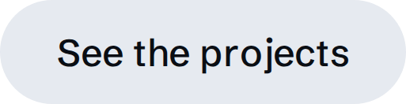

<!-- Each link stays on one line: a line break inside <a> is a space, and GitHub underlines it -->
<a href="https://nexlein.vercel.app"><picture><source media="(prefers-color-scheme: dark)" srcset="assets/hero-dark.svg"><source media="(prefers-color-scheme: light)" srcset="assets/hero-light.svg"></picture></a>

<a href="https://nexlein.vercel.app/#work"><picture><source media="(prefers-color-scheme: dark)" srcset="assets/btn-projects-dark.png"><source media="(prefers-color-scheme: light)" srcset="assets/btn-projects-light.png"></picture></a>
&nbsp;
<a href="https://nexlein.vercel.app/cv.pdf"><picture><source media="(prefers-color-scheme: dark)" srcset="assets/btn-cv-dark.png"><source media="(prefers-color-scheme: light)" srcset="assets/btn-cv-light.png"></picture></a>
&nbsp;
<a href="https://www.linkedin.com/in/nielsen-combebracciale/"><picture><source media="(prefers-color-scheme: dark)" srcset="assets/btn-linkedin-dark.png"><source media="(prefers-color-scheme: light)" srcset="assets/btn-linkedin-light.png"></picture></a>
&nbsp;
<a href="mailto:nielsen.combe-bracciale@epitech.eu"><picture><source media="(prefers-color-scheme: dark)" srcset="assets/btn-email-dark.png"><source media="(prefers-color-scheme: light)" srcset="assets/btn-email-light.png"></picture></a>

